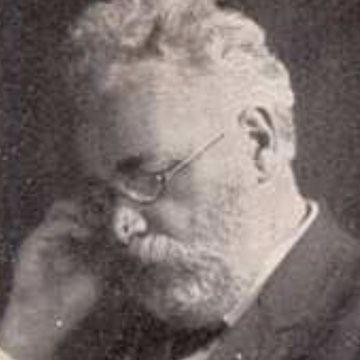

# August Wünsche – Midraschim

[](https://doi.org/10.5281/zenodo.24527651)

[Version 1.0.0](https://github.com/mitkin89/wunesche-midraschim/releases/tag/1.0.0)

<p align="center">
  
  <br><sub>August Wünsche</sub>
</p>

[English](README.md) · **Deutsch**

Deutsche Midraschübersetzungen von August Wünsche, einschließlich der gemeinsam mit Jakob Winter übersetzten und erläuterten *Mechiltha*. Das Repository vereint die zehn derzeit in Safran gebündelten Werke mit den Wünsche-Fassungen von Bereschit, Schemot und Wajikra Rabbah aus Sefaria.

**13 Werke · 5.897 nichtleere Textabschnitte · 5.944 Abschnittsfelder.** Fußnoten und HTML-Formatierung sind erhalten.

| Werk | Ausgabe | Nichtleere Abschnitte | Herkunft |
| --- | --- | ---: | --- |
| [Bemidbar Rabbah](data/Bamidbar_Rabbah.json) | Der Midrasch Bemidbar Rabba. Zum ersten Male ins Deutsche uebertragen von Dr. August Wünsche. Leizig 1885 [de] | 444 | Safran |
| [Bereschit Rabbah](data/Bereshit_Rabbah.json) | Der Midrasch Bereschit Rabba. Zum ersten Male ins Deutsche übertragen von Dr. August Wünsche. Leipzig 1881 [de] | 1,037 | Sefaria |
| [Debarim Rabbah](data/Devarim_Rabbah.json) | Der Midrasch Debarim Rabba; zum ersten Male ins Dt. übertr. von August Wünsche. Leipzig 1882 | 160 | Safran |
| [Echa Rabbati](data/Eikhah_Rabbah.json) | Der Midrasch Echa Rabbati, deutsch von A. Wünsche, Leipzig 1881 (Transkription eScriptorium) | 186 | Safran |
| [Esther Rabbah](data/Esther_Rabbah.json) | Der Midrasch Esther, deutsch von A. Wünsche, Leipzig 1880 (Transkription eScriptorium) | 136 | Safran |
| [Kohelet Rabbah](data/Kohelet_Rabbah.json) | Der Midrasch Kohelet, deutsch von A. Wünsche, Leipzig 1880 (Transkription eScriptorium) | 270 | Safran |
| [Mechiltha (mit Jakob Winter)](data/Mekhilta_DeRabbi_Yishmael.json) | Mechiltha. Ein tannaitischer Midrasch zu Exodus, übersetzt und erläutert von J. Winter und A. Wünsche, Leipzig 1909 | 2,008 | Safran |
| [Midrasch Samuel](data/Midrash_Shmuel.json) | Midrasch Samuel (Aus Israels Lehrhallen V), deutsch von A. Wünsche, Leipzig 1910 (Transkription eScriptorium) | 207 | Safran |
| [Pesikta de-Rav Kahana](data/Pesikta_DeRav_Kahana.json) | Pesikta des Rab Kahana, deutsch von A. Wünsche, Leipzig 1885 (Transkription eScriptorium) | 303 | Safran |
| [Ruth Rabbah](data/Ruth_Rabbah.json) | Der Midrasch Ruth, deutsch von A. Wünsche, Leipzig 1880 (Transkription eScriptorium) | 88 | Safran |
| [Schemot Rabbah](data/Shemot_Rabbah.json) | Der Midrach Schemot Rabba. Zum ersten Male ins Deutsche übertragen von Dr. August Wünsche. Leipzig 1882 [de] | 464 | Sefaria |
| [Schir Haschirim Rabbah](data/Shir_HaShirim_Rabbah.json) | Der Midrasch Schir Haschirim, deutsch von A. Wünsche, Leipzig 1880 (Transkription eScriptorium) | 264 | Safran |
| [Wajikra Rabbah](data/Vayikra_Rabbah.json) | Der Midrach Wajikra Rabba. Zum ersten Male ins Deutsche übertragen von Dr. August Wünsche. Leipzig 1884 [de] | 330 | Sefaria |

## Umfang und Grenzen

Enthalten sind die zehn Rabbah-Werke zu den fünf Büchern Mose und den fünf Megillot, Pesikta de-Rav Kahana, Midrasch Samuel und die Mechiltha. Das ist eine Sammlung der hier verfügbaren digitalen Fassungen, keine vollständige Bibliografie aller Veröffentlichungen Wünsches.

Mehrere Safran-Fassungen sind an Sefarias Abschnittseinteilung ausgerichtet. Ihre `versionNotes` weisen ausdrücklich darauf hin, dass Einleitungen, Anhänge oder abweichende Rezensionen ohne Entsprechung nicht enthalten sind. Bei der Mechiltha fehlen Einleitung, Anhang, Nachträge und Register. Die 47 leeren Abschnittsfelder bleiben erhalten; sie wurden nicht aus anderen Ausgaben ergänzt. Vorhandene OCR-Fehler, historische Schreibweisen und Metadaten bleiben unverändert. Eine vollständige Kollation gegen die Druckausgaben ist damit nicht behauptet.

## Dateien und Verwendung

- `data/<Titel>.json`: unveränderte Quelldateien mit Editionsmetadaten und `text`.
- `links/`: 21 TSV-Dateien mit vorhandenen Quellenverweisen aus Safran. Sie enthalten keine Volltexte der verlinkten Werke. Für die drei Sefaria-Neuzugänge wurden keine zusätzlichen Verknüpfungen erzeugt.
- `sources/sefaria/`: unveränderte Downloads der drei Sefaria-Fassungen und ein Manifest mit URL, Abrufdatum, Versionsmetadaten und SHA-256-Prüfsummen.
- `manifest.json`: Herkunft jeder Datei, Safran-Commit, Prüfsummen und Bestandszahlen.
- `scripts/`: Export und Validierung; unter `scripts/mechilta/` historische Verarbeitungsskripte.
- `docs/mechilta/`: damalige Transkriptions- und Segmentierungsanweisungen zur Dokumentation der Methode.
- `portraits/wuensche.jpg`: das auch in Safran verwendete Porträt.

`text` enthält verschachtelte Listen oder benannte Teile als Objekte. Listenpositionen gehören zur Referenzstruktur und dürfen nicht durch Entfernen leerer Einträge verschoben werden. Die deutschen Texte stehen in manchen Originaldateien technisch unter `language: "English"` beziehungsweise `"en"`; dies ist das übernommene Quellschema. Das Manifest weist die tatsächliche Textsprache als `de` aus. HTML-Tags und Fußnoten sind Teil des Textes.

```sh
python3 scripts/validate.py
python3 scripts/sync_safran.py /pfad/zu/Safran
```

Python 3.9 oder neuer genügt. Der Export aktualisiert die zehn Safran-Werke und verwendet für die drei Sefaria-Werke die lokal archivierten Downloads. Er lädt keine neuen Internetfassungen automatisch. Die historischen Mechiltha-Skripte benötigen ihre damaligen OCR-/Segmentierungsdateien und teils frühere Pfade; sie sind kein eigenständig ausführbarer vollständiger Neubau.

## Quellen und Rechte

Die drei ergänzten Ausgaben sind auf [Sefaria](https://www.sefaria.org/texts/Midrash/Aggadah/Midrash%20Rabbah) veröffentlicht. Die vollständigen JSON-Dateien stammen aus dem in [Sefaria-Export](https://github.com/Sefaria/Sefaria-Export) dokumentierten öffentlichen Export. Die gewählten Fassungen heißen ausdrücklich Wünsche; es wurden keine modernen englischen Übersetzungen übernommen. Sefaria vermerkt bei allen drei Fassungen die Förderung durch die Alfred Freiherr von Oppenheim-Stiftung. Die konkreten Druckquellen und NLI-Links stehen in `versionSource` und im Quellenmanifest.

Bereschit und Wajikra sind dort ausdrücklich als `Public Domain` gekennzeichnet. Bei Schemot enthält der Export kein Lizenzfeld; das Versionsverzeichnis liefert einen leeren Lizenzwert. Diese Angabe bleibt transparent erhalten. Der historische Druck von 1882 wird separat von neuen redaktionellen Beiträgen behandelt. Die zehn weiteren Dateien stammen aus [Safran](https://github.com/mitkin89/Safran); vorhandene `license`- und `versionNotes`-Felder sind unverändert.

Siehe [LICENSE.md](LICENSE.md). Neu erstellte Dokumentation und redaktionelle Aufbereitung: CC BY 4.0; Skripte: MIT. Quellenrechte und Gemeinfreiheitsangaben werden dadurch nicht ersetzt.

## Zitieren

Igor Mendel Itkin (Hg.): *August Wünsche – Midraschim*. Version 1.0.0, 2026. https://doi.org/10.5281/zenodo.24527651. Bitte zusätzlich die jeweilige Druckausgabe und bei den Sefaria-Dateien die dortige Digitalisierung angeben. Siehe [CITATION.cff](CITATION.cff).
